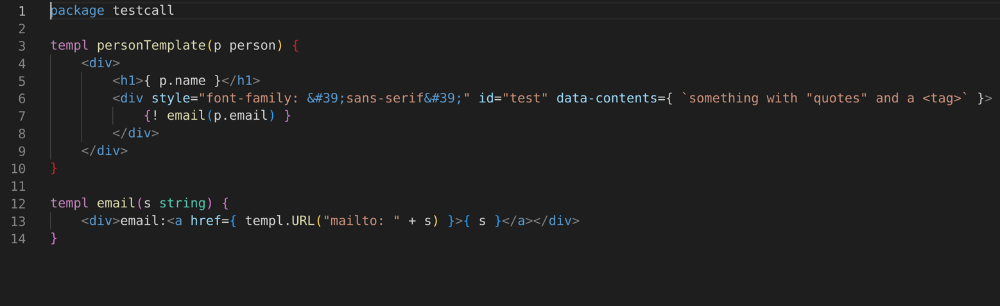

## An HTML templating language for Go that has great developer tooling.




## Documentation

See user documentation at https://templ.guide

<p align="center">
<a href="https://pkg.go.dev/github.com/a-h/templ"></a>
<a href="https://xcfile.dev"></a>
<a href="https://raw.githack.com/wiki/a-h/templ/coverage.html"></a>
<a href="https://goreportcard.com/report/github.com/a-h/templ"></a>
</p>

## Tasks

### version-set

Set the version of templ to the current version.

```sh
version set
```

### build

Build a local version.

```sh
version set
cd cmd/templ
go build
```

### install-snapshot

Build and install current version.

```sh
# Remove templ from the non-standard ~/bin/templ path
# that this command previously used.
rm -f ~/bin/templ
# Clear LSP logs.
rm -f cmd/templ/lspcmd/*.txt
# Update version.
version set
# Install to $GOPATH/bin or $HOME/go/bin
cd cmd/templ && go install
```

### build-snapshot

Use goreleaser to build the command line binary using goreleaser.

```sh
goreleaser build --snapshot --clean
```

### generate

Run templ generate using local version.

```sh
go run ./cmd/templ generate -include-version=false
```

### test

Run Go tests.

```sh
version set
go run ./cmd/templ generate -include-version=false
go test ./...
```

### test-short

Run Go tests.

```sh
version set
go run ./cmd/templ generate -include-version=false
go test ./... -short
```

### test-cover

Run Go tests.

```sh
# Create test profile directories.
mkdir -p coverage/fmt
mkdir -p coverage/generate
mkdir -p coverage/version
mkdir -p coverage/unit
# Build the test binary.
go build -cover -o ./coverage/templ-cover ./cmd/templ
# Run the covered generate command.
GOCOVERDIR=coverage/fmt ./coverage/templ-cover fmt .
GOCOVERDIR=coverage/generate ./coverage/templ-cover generate -include-version=false
GOCOVERDIR=coverage/version ./coverage/templ-cover version
# Run the unit tests.
go test -cover ./... -coverpkg ./... -args -test.gocoverdir="$PWD/coverage/unit"
# Display the combined percentage.
go tool covdata percent -i=./coverage/fmt,./coverage/generate,./coverage/version,./coverage/unit
# Generate a text coverage profile for tooling to use.
go tool covdata textfmt -i=./coverage/fmt,./coverage/generate,./coverage/version,./coverage/unit -o coverage.out
# Print total
go tool cover -func coverage.out | grep total
```

### test-cover-watch

interactive: true

```sh
gotestsum --watch -- -coverprofile=coverage.out
```

### test-fuzz

Run each fuzz test for FUZZTIME (default 120s).

```sh
./parser/v2/fuzz.sh
./parser/v2/goexpression/fuzz.sh
./runtime/fuzzing/fuzz.sh
./internal/jstokenizer/fuzzing/fuzz.sh
```

### test-fuzz-corpus

Run the runtime and JavaScript tokenizer fuzz tests against their seed and committed corpora, without fuzzing. These fuzz tests are in separate modules, so that their JavaScript engine and parser dependencies are not dependencies of templ, and `go test ./...` in the root module doesn't run them. The parser fuzz tests are in the root module, so `test` and `test-cover` run their corpora.

```sh
(cd runtime/fuzzing && go test ./...) &&
	(cd internal/jstokenizer/fuzzing && go test ./...)
```

### benchmark

Run benchmarks.

```sh
go run ./cmd/templ generate -include-version=false && go test ./... -bench=. -benchmem
```

### benchmark-fmt

Run the templ fmt benchmarks, which include the time taken by prettier.

```sh
go test ./internal/format -run '^$' -bench BenchmarkTempl -benchtime 3x
```

### fmt

Format all Go and templ code.

```sh
gofmt -s -w .
go run ./cmd/templ fmt .
```

### lint

Run the lint operations that are run as part of the CI.

```sh
golangci-lint run --verbose
```

### vulncheck

Check for known vulnerabilities in dependencies that templ calls.

```sh
govulncheck ./...
```

### ensure-generated

Ensure that templ files have been generated with the local version of templ, and that those files have been added to git.

Requires: generate

```sh
git diff --exit-code
```

### push-release-tag

Push a semantic version number to GitHub to trigger the release process.

```sh
version push --prefix="v"
```

### docs-run

Run the development server.

Directory: docs

```sh
npm run start
```

### docs-build

Build production docs site.

Directory: docs

```sh
npm run build
```

